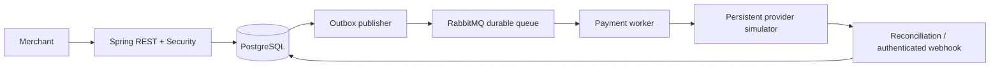

# TrustPay — reliable payment processing with identity controls

[Portfolio case study](https://zlatko-anastasov-portfolio.vercel.app/trustpay.html) · [Interactive demo](https://trustpay-demo.vercel.app) · [Reviewer walkthrough](docs/LIVE-DEMO.md)

A Java 21 / Spring Boot portfolio backend demonstrating payment correctness under retries, concurrent requests, provider timeouts and process failures. PostgreSQL is the system of record; RabbitMQ transports durable payment events. All identities and payments are synthetic.

## Start

Prerequisites: Docker Engine with Compose. First build downloads Maven dependencies and images.

```sh
docker compose up --build -d
curl http://localhost:8080/actuator/health
python3 scripts/demo.py
```

OpenAPI: http://localhost:8080/swagger-ui/index.html
RabbitMQ management: http://localhost:15672 (trustpay / trustpay).
Stop with `docker compose down`; retain volumes to preserve transactions. `down -v` explicitly deletes demo data.

For local development, start dependencies with `docker compose up -d postgres rabbit provider`, then run `sh ./mvnw spring-boot:run`. Tests use isolated PostgreSQL Testcontainers: `sh ./scripts/test.sh` (automatically selects the active Docker context, including Colima). On standard Linux Docker, `sh ./mvnw verify` also works. Docker must be running. Tests must pass rather than silently skip without Docker.

## Demo accounts

| Account | Password | Permission |
|---|---|---|
| merchant | merchant-demo | Own customers, payments, ledger and audit |
| other | other-demo | A second isolated merchant |
| ops | ops-demo | Identity review and reconciliation |

Authentication supports signed JWT bearer tokens with issuer/expiry validation and a 15-minute lifetime. Obtain a token with `curl -u merchant:merchant-demo -X POST localhost:8080/api/token`, then pass `Authorization: Bearer TOKEN`. HTTP Basic also remains available for the local demo. Configure `MERCHANT_PASSWORD`, `OTHER_PASSWORD`, `OPS_PASSWORD`, and `JWT_SECRET`, and `PROVIDER_SECRET` consistently for app and simulator outside local use. Put TLS and an external identity provider in front of a real deployment; no production identity integration is claimed. Ports are bound to loopback.

## API flow

```sh
curl -u merchant:merchant-demo -X POST localhost:8080/api/customers
# Replace CUSTOMER_ID with the returned id.
curl -u ops:ops-demo -X PUT localhost:8080/api/ops/customers/CUSTOMER_ID/identity \
  -H 'Content-Type: application/json' -d '{"status":"VERIFIED"}'
curl -u merchant:merchant-demo -X POST localhost:8080/api/payments \
  -H 'Idempotency-Key: order-001' -H 'Content-Type: application/json' \
  -d '{"customerId":"CUSTOMER_ID","amount":10000,"currency":"EUR"}'
```

Amounts are integer minor units. Supported currencies EUR, USD and GBP have two decimal places. Maximum demo payment is 100,000 major units. No FX, card handling, real KYC or real movement of money.

`POST /api/payments` returns 202 with a durable operation. Poll `GET /api/payments/{id}`. Repeating the same merchant/key/payload returns the same operation; changing the payload returns 409. Unverified identity returns 422. Other merchants receive 404. The key scope is merchant plus key, retained for the lifetime of the operation.

Additional routes: `GET /api/payments?limit=20`, `GET /api/payments/{id}/ledger`, `GET /api/payments/{id}/audit`, `POST /api/ops/reconcile`, `GET /api/ops/reconciliation-cases`. Shared-secret authenticated `POST /api/provider/webhook` accepts `paymentId`, `status`, `amount`, `currency` with `X-Provider-Secret`. Production webhooks should use timestamped HMAC signatures and secret rotation; this prototype uses a constant-time shared-secret comparison and state-based duplicate protection.

## Failure demonstrations

The persistent provider simulator deterministically chooses behavior from the amount:

| Minor units | Behavior |
|---|---|
| 10000 | Successful payment |
| 1300 | Declined payment |
| 9900 | Accepted by provider, response delayed past client timeout |

The last case becomes UNKNOWN, then reconciliation queries the same provider operation and settles it. Unknown outcomes are never treated as declines. Provider keys are payment UUIDs, so resubmission uses the same provider operation.

Run `python3 scripts/demo.py` for assertions covering identity gating, 20 simultaneous retries, changed-payload conflict, merchant isolation, success, decline, duplicate webhook and timeout recovery. The script creates fresh demo records and prints their IDs.

## Architecture



Logical boundaries are API/security, payment domain, ledger, messaging, provider adapter and reconciliation. A single deployable keeps the demo understandable and local transactions explicit. See [architecture decisions](docs/architecture.md), [operations runbook](docs/runbook.md) and [performance workflow](docs/performance.md).

## Correctness guarantees

* A transaction-scoped PostgreSQL advisory lock serializes matching idempotency keys. A unique constraint remains the final guard. Customer identity is checked under a shared row lock.
* Payment and outbox event commit together. Publishing uses persistent messages, mandatory routing and publisher confirms. A crash after publish and before marking the outbox can duplicate an event; event IDs are deduplicated in PostgreSQL.
* The consumer commits its event receipt and PROCESSING transition before the external call. A crash after this commit is recovered by reconciliation, which scans PROCESSING and UNKNOWN operations.
* Final transitions lock the payment row. A successful settlement and one balanced ledger transaction commit atomically. Each ledger row represents a debit/credit pair with equal positive amounts in one currency; payment ID is unique.
* Duplicate final callbacks have no further financial effect. Contradictory results and amount/currency mismatches create deduplicated review cases.

These are local database and provider-idempotency guarantees, not a claim of end-to-end exactly-once delivery. Provider idempotency and lookup are explicit assumptions.

## Operations: review cases, cache, AI assistant, tracing, Kubernetes

Each of these has a short decision record in [docs/decisions](docs/decisions).

* **Review cases (JPA/Hibernate).** Reconciliation cases are work items: `GET /api/ops/review-cases`, then `POST /{id}/resolve` with a resolution (`ACCEPT_PROVIDER_RESULT`, `KEEP_LEDGER`, `ESCALATE`), a note and the version you loaded. `@Version` optimistic locking means two operators can never both decide one case; the loser gets `409`. Every decision is audited. The payment path stays on explicit SQL ([why](docs/decisions/0001-jdbc-for-money-jpa-for-review.md)).
* **Redis cache.** Merchant balances and payment retries. Transaction-aware (writes after commit) and fail-safe (a Redis error is a miss, never a failed payment); the database always decides ([why](docs/decisions/0002-cache-is-optional.md)).
* **AI review assistant (Spring AI).** `POST /api/ops/review-cases/{id}/assist` stores a summary and a suggested resolution; a human still resolves. Payment facts only, validated output, low confidence becomes `ESCALATE`, 10 s timeout, deterministic fallback ([why](docs/decisions/0003-ai-suggests-never-acts.md)). Locally and for free: `AI_ENABLED=true docker compose --profile ai up -d`, then `docker compose exec ollama ollama pull llama3.2`.
* **Tracing (OpenTelemetry).** One trace per payment across the HTTP request, the RabbitMQ message and the provider calls; `X-Request-Id` is the trace id. Jaeger: http://localhost:16686 ([why](docs/decisions/0004-tracing.md)).
* **Kubernetes.** [`k8s/base`](k8s/base): the API (2 replicas, non-root, read-only filesystem, all capabilities dropped, seccomp, probes on `/actuator/health/liveness` and `/readiness`, PodDisruptionBudget) and Redis behind a NetworkPolicy, in a namespace that enforces the *restricted* Pod Security Standard. CI scans them with [kubesieve](https://github.com/zaremifa-cell/kubesieve) (fails on any medium finding), then deploys [`k8s/overlays/kind`](k8s/overlays/kind) to a kind cluster and smoke-tests the API through the Service.

## Scope and next steps

This is a runnable portfolio reference, not a certified payment institution. It includes no refunds, settlements to bank accounts, FX, sanctions screening, document verification or multi-region failover. The operational identity decision is simulated. Ledger and audit are append-only through the application APIs; a database owner can still mutate them. A real deployment needs restricted database roles, stronger audit storage, external authentication, signed webhooks, retention policy and operational alerting.

CI runs PostgreSQL and Redis integration tests, builds the full Compose stack, deploys to a kind Kubernetes cluster, and executes the live demo and failure-injection scripts on GitHub Actions. Performance figures are only valid when accompanied by the actual hardware, dataset and commands in the verification report.

## Verified evidence

See [verification report](docs/verification.md) for executed checks, measured SQL plans, HTTP timings and a recorded JVM profile. The CI definition is supplied; no remote GitHub run is claimed.

## Online reviewer sandbox

The same Java backend has a Vercel cloud deployment profile, with a private Vercel Queues adapter and PostgreSQL-backed provider simulator. See [five-minute walkthrough and cloud architecture](docs/LIVE-DEMO.md). Local Compose continues to use RabbitMQ.
